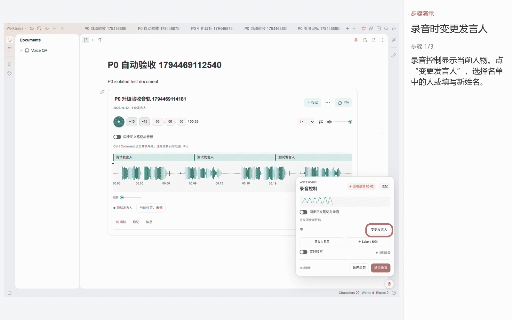
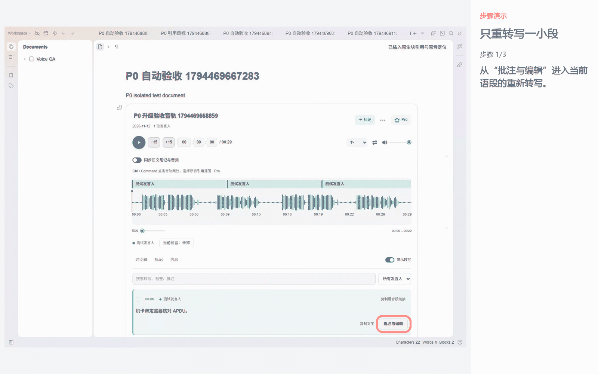
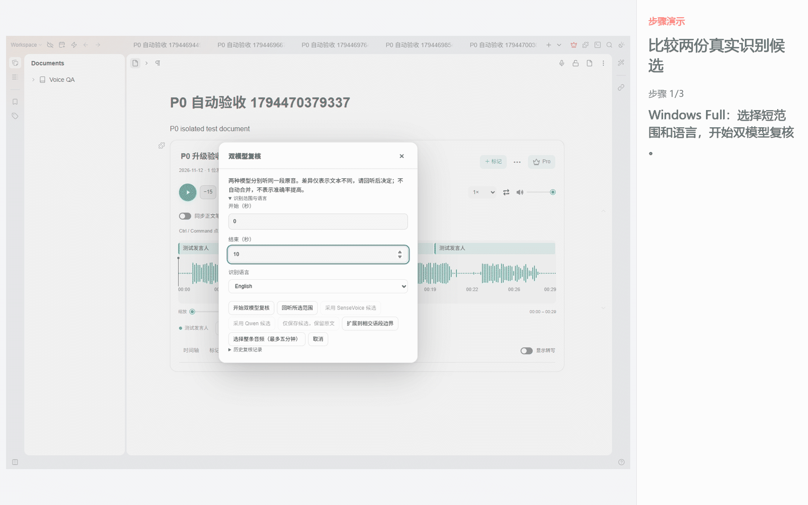
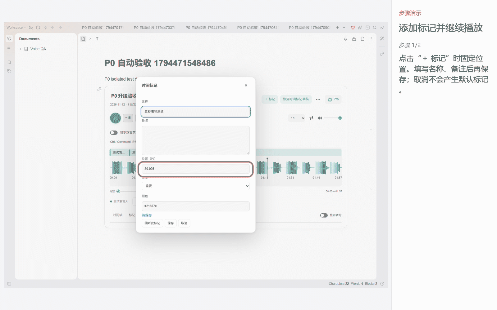
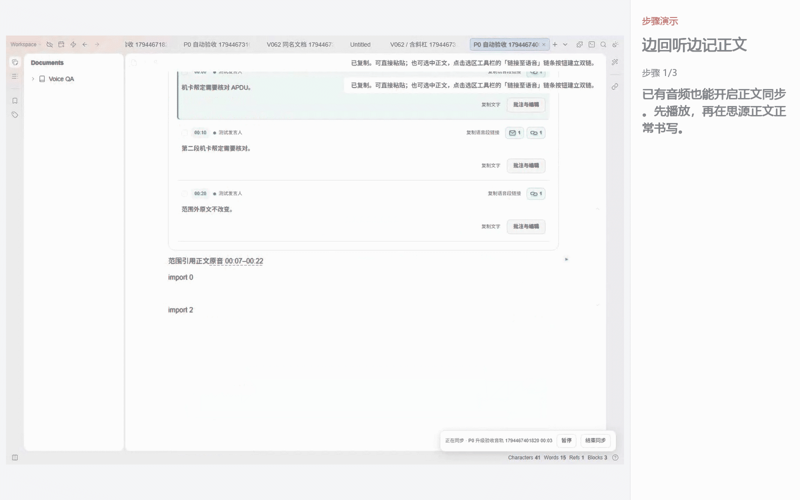
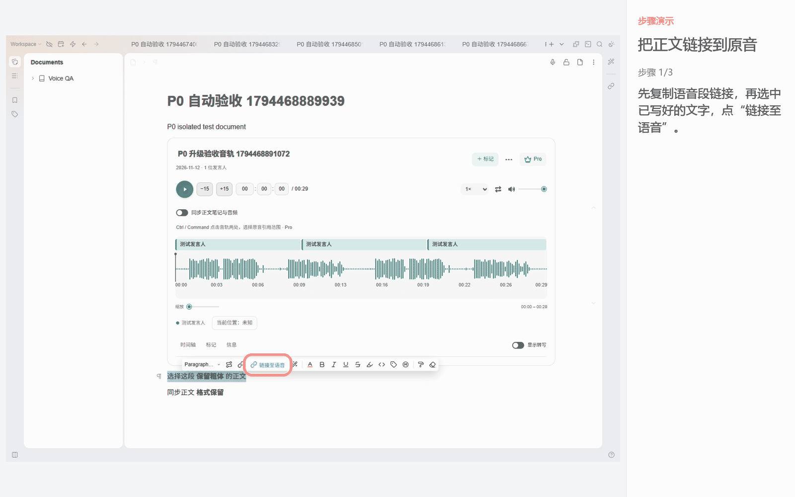

# 思源语音使用手册

## 删除选中语音与撤销

按住 Ctrl（Mac 用 ⌘）在波形上拖选，或在逐字稿中勾选带时间的语段，再点顶部的「删除选中语音」。播放器会拼接剩下的音频，移除选区内的整句、发言人标注和时间标签，并把后面的时间向前移动。选区只覆盖一句话的一部分时，保留这句文字并标为估算，可回听校对。

在播放器中按 Ctrl+Z（Mac 用 ⌘Z）可恢复上一次删除的原始音频和全部标注。连续删除可以逐次撤销，也可从「更多操作」→「音频与文件」点「撤销删除语音」。撤销记录保存在当前插件会话中，重新加载插件或退出思源后会清空。

## 整段转写与发言人

在 Full 播放器顶部点「语音转文字」。已有定时语段时会先询问是否重新转写，旧稿可以撤销恢复。「显示转写」只负责展开或收起文字。在标题下点「识别发言人」，完成后音轨会出现人物色带。分析中可点「取消识别」。录音控制里的「结束后自动区分发言人」决定录完要不要自动分析。

## 会议录音

打开要保存会议的文档，点上方声波图标 →「会议录音」。听对方发言时选「只录系统声音」，要把自己的话一起留下，选「系统声音和麦克风」。在本机浏览器打开思源时，选正在开会的标签页，勾选共享标签页音频。Windows 或支持系统音频采集的 Mac 桌面端可直接录电脑当前播放的声音。

点「结束录音」后，两路声音保存在同一条音轨上，可以照常做标记、裁剪、引用。Full 录音时可以勾选「实时转写」，会后再按需要区分发言人。Lite 可以导入已有字幕。

2026-11-13 同版本修订：新增音轨发言人右键变更/清除及自动分析人数设置。详见[发言人识别与修正](发言人识别与修正.md)。

适用版本为 0.9.0。以下操作以思源 3.8.9、Windows 和桌面编辑器为例。Lite 和 Full 使用同一个语音块格式；本轮录音演示由测试音频输入 MediaRecorder，不能代替真实麦克风权限验收。

## 选择版本并安装

0.8.3 起，Full 集市包附带主转写与发言人模型，双模型复核另需 Windows x64 完整扩展。Full 启用时会将 `offline` 目录加入思源同步忽略列表，录音和笔记照常同步。首次安装后先启用插件、检查同步排除，再进行云同步。Lite 不显示自动识别相关入口。

已经有字幕、主要想录音和手动整理，选 Lite。需要本机自动转写、发言人分段和声纹绑定，选 Full。本轮 Full 的第二模型组件适用于 Windows x64。Qwen 短样本实际峰值进程内存约 6 GB，内存紧张时先用主模型。

手动安装时，Full 解压到 `data/plugins/siyuan-voice-notes`，Lite 解压到 `data/plugins/siyuan-voice-notes-lite`，让 `plugin.json` 直接位于对应目录。先结束录音、退出思源并备份工作空间。

Full 的部分运行库文件路径较长。如果解压工具报告路径过长，停止安装，使用支持 Windows 长路径的解压工具或选择较短的工作空间路径；不要忽略解压错误后继续启用。

启用后打开一篇可编辑文档，面包屑会出现麦克风。插件设置中有“查看版本与模型”，可以查看 Lite/Full 类型。Full 的“校验离线资源”会逐文件检查哈希，需花一些时间；发现缺失时重新解压完整包即可，不会自动联网下载。

Lite / Full 使用独立插件目录，请只启用一个版本。切换后，在旧语音块的块菜单选择“用 Lite / Full 打开此语音块”，保留块 ID、原音频和内容。操作前会保存语音数据备份。详细安装和切换步骤见 [安装说明](../../INSTALL.md)。

## 了解哪些操作需要 Pro

录音、导入、播放、手动人物、字幕、普通文本编辑、批注、导出都可免费使用。本地识别由 Full 提供。

Label 新建与编辑、录音改名免费。Pro 用于专业词库与纠错、自动正文同步、新的精确原音双链和重新定位。语段、批注、波形范围和正文工具栏的精确关联均遵循同一规则。清除授权后，旧资料仍可阅读、回听、导出和删除；原样复制已有关系不需要重新购买。

语音块的「更多操作」→「音频与文件」→「Pro」以及插件设置里的 Pro 都能打开授权窗口。授权沿用思源账号 ID，同一账号可使用已有授权码。授权窗口提供购买入口，插件不会自动下单。请勿把测试版授权构建作为发行插件。

## 在正文指定位置开始录音

1. 在正文中点击想放语音块的位置。
2. 点击面包屑麦克风，选择“开始录音”。首次使用由系统询问麦克风权限。
3. 点击右下角录音按钮打开控制。可以暂停、继续，最后选择“结束录音”。
4. 保存后，语音块插入开始录音时记录的位置。等待期间原段落被修改时会采用保守回退并提示；不要为恢复位置而覆盖正文。

“开始录音”旁的快捷键入口和插件设置中的“设置快捷键”可以配置同一个录音快捷键。请避开思源已有组合。快捷键配置界面仍需在自己的键盘布局上试用。

暂停期间音频时间不继续累计。收起录音控制不会结束录音。结束后如正在自动人物分析，可以选择“跳过分析并保存”，先保住原音。

## 在录音时切换说话的人

适用：Lite/Full，Free/Pro。

会前点麦克风菜单的“会前设置参会人”，每行填写一个姓名并保存。录音中点“变更发言人”，可以从“参会人”下拉框选择，也可以按表单输入新姓名。确认后，从当前音频时刻开始登记新的发言区间；取消不改变当前人物。

图为本轮隔离思源界面的步骤演示。结束录音后，人物名称显示在时间轴色条上，名字保持正常字形。Full 可以用「声纹绑定」保存试听确认的人物样本，并重新分析本条录音。同一工作空间的后续识别也会使用这些样本。

## 隐私模式下控制录音

在开始前开启“隐私模式 · 仅在面包屑提示录音”。录音时不出现右下角浮动按钮，面包屑仍显示正在录音。再次点击面包屑，选择“打开录音控制”可以使用完整控制，也可以直接选“结束录音”。隐私模式不会隐藏系统自己的麦克风权限提示。

## 导入手机录音或已有音频

适用：Lite/Full，Free/Pro。

1. 在正文定位光标，打开麦克风菜单，选择“导入音频”。
2. 填写名称、日期、发言人和标签。名称留空使用文件名。
3. 选择多个文件，或把文件拖入这个表单。
4. 等待“已插入 N 条”。某个文件失败会列出原因，其他可读取文件仍继续导入。

本轮用实际编码文件验证了 WAV、MP3、M4A、AAC、FLAC、OGG、OPUS、WebM 和 MP4。它们由公开音频转码得到，未遍历所有手机型号；同一扩展名的不同编码仍可能不兼容。无法解码时先用其他音频工具转换，不会创建空壳语音块。视频按宿主可播放的媒体资源导入，本插件没有内置格式转换器。

## 给音频配字幕

导入表单展开“可选：导入字幕 SRT / VTT / TXT”，先选字幕再选音频，也可把两者一起拖入。单音频可以搭配不同名字幕；批量文件按不含扩展名的同名关系配对。多个字幕争用同一音频时会提示，先整理好文件名。

已有语音块可在“信息”的导入区域追加字幕。SRT/VTT 使用文件内时间；TXT 没有时间时保留为未定位文字，不生成精确时间戳。已有内容时，表单会显示原段数和追加段数，确认后保留原转写并追加，取消不写入。重复时间范围也会保留为独立语段，先导出 JSON 可以方便回退。本轮实际验证了 SRT/VTT/TXT 追加、取消及重开。

## 回听与定位

播放键负责播放/暂停。前后按钮跳十五秒，倍速提供 0.5、0.75、1、1.25、1.5、2 倍；音量与循环在播放器中设置。

可以点击波形或语段时间定位，也可以输入 HH:MM:SS，按 Enter 或离开整组时间输入后提交。Escape 取消时间编辑。音轨缩放后，用横向浏览控制查看其他范围。发言人色条的姓名不会随缩放拉伸。

已关联正文的回听入口位于正文右侧。点击后使用小型回听控件，默认提前三秒还原上下文。设置中的“正文回听提前量（秒）”可改为 0 至 30 的整数；回听控件的“继续完整录音”可以解除片段结束限制。

## 修改录音名称

适用：Lite/Full，Free/Pro。双击录音块左上角名称，会出现就地输入框。修改后按 Enter 或点击“保存名称”；按 Esc 或点击“取消改名”可放弃。名称不能为空。只改名称，不改音频文件、语段 ID、引用或播放位置。

## 音频无法播放或提示无法解码

在「信息」页核对音频路径，确认工作空间的 assets 目录已同步该文件。设备无法解码时，可将原文件转成 WAV 或 MP3 后另行导入。

“无法解码”不表示插件删除了录音。网页错误响应、缺失资源、不完整传输和不受支持的编码会给出不同提示。不要删除现有语音块；它仍保存转写、人物、批注和引用。0.8.1 修复了长音频重绘后输出被关闭造成的无声；升级后重新打开语音块，使旧的输出链路释放。

打开语音块，插件会按时间顺序读取各声道，画出整条波形。长录音可能需要稍等。点波形定位后，按空格播放或暂停。放大后，播放指针越过当前窗口，时间轴会跟到新位置。

## 修改已保存录音的发言人

适用：Lite/Full，Free/Pro。

只改一句话：点击该段“批注与编辑”，选择“发言人”，保存语段。它会成为人工更正，自动分析不应把它覆盖。

从某时刻换人：先定位音频，在当前位置人物入口或右上角“更多操作”中选择“从此处切换发言人”。确认表单显示的范围和姓名后保存。范围到下一次已存在的切换为止，不会把之后所有切换清掉。

要调整切换记录，打开“更多操作”→“发言人切换记录”。“修改时刻”会预览相邻区间调整；“删除切换记录”会提示是否继承上一位人物。跨边界的长句无法仅凭文本判断哪几个字属于谁，请回听后拆分或手工选择人物。

## 生成和编辑逐字稿

Lite 可直接打开“显示转写”，使用“手动添加转写”填写文字、人物、开始和结束秒数，或导入字幕。没有时间的内容留空，不必猜一个时间。

Full 可选择“识别语言”，固定普通话、English、粤语，或使用自动模式。整条转写或局部识别都在本地完成，模型可能识别错人名和专业词。词库是人工校对辅助，当前 SenseVoice 链路没有热词偏置。

文字本身可以选择复制；右侧“复制文字”只复制逐字稿。点击“批注与编辑”可以编辑转写、人物、标签和时间；先点“保存语段”，再执行下方其他操作。拆分与“合并下一段”位于同一行。合并不同人物的句子会保留为混合/未知，不据此认定同一个人。

搜索框可查找内容，旁边按人物筛选，长逐字稿按页显示。删除语段及其批注有确认步骤，删除前建议导出 JSON。

## 只重新识别听错的部分

适用：Full，Free/Pro。

1. 在语段“批注与编辑”里选“此语段重新转写”，或在“更多操作”中选“局部重新转写”。
2. 核对开始、结束时间和语言；连续多段也可组成范围。范围切到已有语段内部时先拆分或扩展边界。
3. 点“识别所选范围”。计算期间原文保持不变。
4. 在结果文本框里直接校对，再点“确认替换此范围”。不满意时取消。
5. 需要恢复时，在“更多操作”里选“撤销上次批量纠错 / 重转写”。

图中结果来自实际离线推理，步骤演示不表示识别速度。替换保留范围外文字；旧批注进入历史语段存档，旧原音引用仍按原绝对时间回听。识别期间若其他视图修改同一范围，应用会被拒绝，请重新核对。

## 双模型复核的使用条件

适用：Windows x64 Full。两个模型和便携运行组件已通过公开音频真实推理。浏览器中的复核表单使用测试传输连接真实模型，验证了候选、修改、提交和重开；原生桌面窗口验证本轮由用户选择暂时跳过，仍待验收。

入口是“更多操作”→“双模型复核”。选择范围和语言，点击“开始双模型复核”。两份候选使用同一份 16 kHz 单声道 PCM，并记录音频哈希、模型版本和输入范围。差异提示只是文本差别，不是识别置信度。

可回听所选范围、修改候选，然后选择“采用 SenseVoice 候选”“采用 Qwen 候选”或“仅保存候选，保留原文”。Qwen 的候选只有输入范围，没有字词级定位。当前一次最多五分钟；较长录音分段处理。历史分歧可以再次选择范围复核，不做无依据的自动融合。

未配置云端服务，不需要 API Key。取消会终止本次子进程；安装不完整或内存不足时保留旧逐字稿。Qwen 本轮短样本的新进程测试约十四至六十三秒，受首次文件读取和系统负载影响。不能据此推算长录音耗时或其他电脑速度。

动图来自上述测试传输环境，两份候选由真实模型生成；它不代表原生桌面窗口已经验收，也不展示完整计算等待时间。

长片段会分配更多文字生成额度。如果模型触及额度但没有正常结束，插件会提示缩短范围，并保留旧稿；不要把截断结果当成完整逐字稿。

## 给重要时刻加 Label

Label 的新建、编辑、回听和删除均免费，录音中的 Label 也是如此。

录音中点打标记入口，填写名称和备注后确认。播放已保存音频时点“＋ 标记”，表单中的位置固定为点击那一刻。填写多久都不会把标记推迟到保存时刻。

新建表单必须明确点“保存”；点取消或关闭不会创建默认标记。已有标记的浮窗支持编辑名称、备注、时间、类型和颜色，离开后自动保存；保存失败会保留提示供重试。要回到标记位置，请明确点“回听此标记”，普通保存不应跳回开头。

## 为一句话写批注

适用：Lite/Full，Free/Pro。

点击语段“批注与编辑”→“写批注”，填写内容、类型和需要的时间范围。批注类型可在语音块“更多操作”→“设置批注类型”中维护。

有批注的语段会显示数量徽标，悬停可预览，点击打开详细管理。重转写后的旧批注仍在历史语段中保留。复制批注文字免费；“复制批注链接”会创建精确原音关联，需要 Pro。

## 边录音或边回听边写正文

适用：Lite/Full 的 Pro。

录音时在控制面板打开“同步正文笔记与录音”；已有音频在语音块打开“同步正文笔记与音频”并播放。之后直接在思源正文输入，正常创建段落，不必进入插件编辑器。

新块和已有正文的首次实际修改会建立时间关联。继续修改同一段不会随意覆盖原时刻。单纯点击、选中文本或滚动不创建关联。暂停期间不累计暂停时长；停止录音或关闭同步后不继续追踪。

可以切换文档继续写，一个录音关联多篇文档。已有音频同步只允许一个当前来源，录音和播放同步不能冲突运行。保存后，正文右侧的小播放按钮可回听；多个来源时先选录音。

## 把一句原话引用到别处

在标题下点「插入双链」，可将原音引用直接插入语音块下方。有选区时引用选区，否则引用当前语段或时刻。此功能需要 Pro。

1. 在语段右侧点“复制语音段链接”。编辑表单里也有同名入口。
2. 在正文直接粘贴，生成思源原生块引用。
3. 若正文已经写好，选中需要关联的文字，点选区工具栏“链接至语音”；块右键菜单也可关联已复制的语音段。
4. 引用旁的回听入口可播放原音。“跳转到录音”返回来源，语段右侧的链接数量入口列出反向引用的正文。

按住 Ctrl（Mac 用 Command）在波形上点两处或拖出一段。选好后，可以点“复制所选音频链接”，Full 还可以点“转写所选片段”。如果选区只截取了已有语段的一部分，可点“保留原句，添加选段转写”。也可以在逐字稿中用两个语段的时间按钮选择引用范围。引用保存固定毫秒范围，后续改字、拆分、合并或更换人物名称都不应让原音漂移。

## 复制带声音关联的正文

使用思源内的富文本复制与粘贴，已有正文关联会随内容保留；可以跨文档复制整段或所选部分。纯文本粘贴会去掉富文本关系，经过外部纯文本程序中转也可能丢失。

Free 可以原样迁移已有关系，但不能利用旧剪贴板给任意新文字创建新的插件精确关联。原生普通块引用仍由思源处理。移动正文块保持块 ID，回听不依赖它在文档中的行号。

## 维护专业词库并批量校对

适用：Lite/Full，需要 Pro。普通逐字稿手动编辑和撤销已有修改仍免费。

插件设置→“管理全局词库”维护通用专业词和精确纠错映射。某条录音专用的词在“更多操作”→“本条录音附加词库”中维护，不污染全局。支持搜索、编辑、删除，以及 TXT/JSON 导入导出。

在语段“批注与编辑”中选择“校对词汇 / 加入词库”，填错误词和正确词。可以只修改当前词，或“预览本条录音全部替换”。预览显示匹配数量和前后文本，确认后才修改。可同时加入个人规则，后续仍须预览确认，不会静默修改全部历史录音。

大小写、全角半角分别匹配，英文词避免误替换较长单词中的片段。批量改字保留原音时间和人物，撤销入口与局部重转写共用。

## 导出逐字稿和备份

“更多操作”→“逐字稿与校对”→“导出逐字稿”，勾选是否带时间戳、是否带发言人，再点“下载逐字稿 TXT”。导出使用当前已编辑文字。不要把 TXT 当成可恢复全部批注和引用的备份。

完整结构用 VoiceKnowledge JSON。原位导回的入口在“信息”→“高级 / 导入与恢复”→“从 JSON 更新本条录音”。核对预览和录音 ID 后确认，先备份再写入。JSON 保存资源路径，不含音频本体；跨工作空间需同时迁移 assets 和引用文档。

## 出现问题时保留哪些资料

找不到声音时先检查资源是否同步完成、是否仍在 assets 中，不要急着删除语音块。旧引用文字和原生跳转尽量保留；恢复资源后再试回听。

录音保存失败时，打开麦克风菜单的“恢复未保存录音”，选择“恢复录音”。如果原插入段落已删除，先把光标放在新的目标处，再重新打开恢复列表，选择“恢复到当前光标位置”并确认。录音 ID 和已登记的正文时间关联保持不变。不要反复导入同一份草稿。

确定不需要某份草稿时，选择“删除此录音草稿”，输入“删除”确认。它只清理这份草稿的本地片段，不删除已保存原音。无法读取的片段不能保证恢复完整音频，不要把损坏检测当作修复承诺。本轮验证了插入点删除后的恢复，没有真实断电、休眠和移动端后台恢复证据。

编辑冲突时保留当前文本，重新打开表单核对最新数据。旧 schema 可读取，新增来源字段缺省时按未知来源处理，避免把旧人工人物当成自动结果覆盖。

## 查看帮助与验证范围

插件设置→“打开使用手册”使用安装包内的 HTML，图片和样式都在本地。动图由本轮真实界面截图或录屏制作，标有步骤演示的动画不反映操作耗时。

Windows 隔离内核和浏览器测试、实际 CPU/WASM 推理，与真实桌面窗口、麦克风设备、手机触屏是不同验证范围。后几项未完成时会在测试报告标明，不据此承诺全平台相同行为。双模型没有人工参考稿，未计算识别准确率，也没有宣称优于任一单模型。
